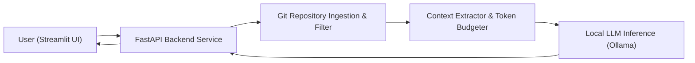

# 🧠 GitHub Code Explainer — AI Repository Intelligence

<p align="center">
  
</p>

<p align="center">
  An AI-powered GitHub repository intelligence and code explanation engine utilizing FastAPI, Streamlit, and local LLM connectors to inspect source trees, extract structural context, and generate comprehensive architecture explanations.
</p>

<p align="center">
  <a href="https://github.com/prakruthidevanga/GitHub-Code-Explainer">
    
  </a>
</p>

<p align="center">
  
  
  
  
</p>

---

## 📌 Table of Contents

- [📖 Project Overview](#-project-overview)
- [🎯 Objectives](#-objectives)
- [✨ Key Features](#-key-features)
- [🏗️ System Architecture](#️-system-architecture)
- [🛠️ Technology Stack](#️-technology-stack)
- [📁 Repository Structure](#-repository-structure)
- [⚙️ Installation and Setup](#️-installation-and-setup)
- [🔮 Future Enhancements](#-future-enhancements)
- [🤝 Contributing](#-contributing)
- [👩‍💻 Author & Accreditations](#-author--accreditations)

---

## 📖 Project Overview

Navigating complex open-source repositories with unfamiliar design patterns is one of the most time-consuming phases of software development. **GitHub Code Explainer** provides an end-to-end local GenAI pipeline that inspects repositories, extracts key implementation files, and utilizes on-premise language models to produce comprehensive code walkthroughs.

By utilizing a dual-service architecture (FastAPI backend service and Streamlit client), the platform ensures high responsiveness, modular prompt construction, and complete privacy by executing inferences through local models.

💡 **Core Mission:** Provide instant, understandable code briefings for any public GitHub project without relying on paid third-party AI APIs.

---

## 🎯 Objectives

- 🔍 **Automate Codebase Ingestion:** Accept public GitHub URLs and create isolated shallow working trees.
- 🧩 **Extract Architectural Context:** Distill complex directory trees and focus on substantive source logic.
- ⚡ **Dual Client-Server Separation:** Decouple the frontend UI (Streamlit) from the underlying LLM processing service (FastAPI).
- 🛡️ **Preserve Data Confidentiality:** Keep codebase inspection entirely local to avoid cloud IP exposure.

---

## ✨ Key Features

### 🚀 1. Fast Repository Cloning
Clones public repositories into temporary scratch directories, isolating third-party code from local environments.

### 🧠 2. Local LLM Service Connector
Integrates seamlessly with local Ollama or custom model backends via HTTP REST endpoints.

### 📊 3. Interactive Streamlit Interface
User-friendly dashboard providing code snippets, architectural summaries, and dependency lists.

---

## 🏗️ System Architecture



---

## 🛠️ Technology Stack

<p align="center">
  
</p>

| Component | Technology | Implementation Role |
| :--- | :--- | :--- |
| **Backend API** | FastAPI / Python | RESTful endpoints handling cloning and prompt assembly |
| **Frontend UI** | Streamlit | Interactive web application for developer inputs and reports |
| **Repository Operations** | GitPython | Shallow cloning and tree traversal |
| **Inference Engine** | Local LLM Connector | Interface with local Ollama runtime |

---

## 📁 Repository Structure

```text
GitHub-Code-Explainer/
├── backend/
│   ├── llm_service.py           # LLM connector and prompt templates
│   └── repo_processor.py        # Repository cloning and filtering logic
├── frontend/
│   └── ollama_connector/        # Ollama interface utilities
├── app.py                       # Streamlit application dashboard
├── requirements.txt             # Python dependency manifest
└── README.md                    # Project documentation
```

---

## ⚙️ Installation and Setup

### Prerequisites
- Python 3.10+
- Git installed on PATH
- Local Ollama running with an installed model (`mistral` or `llama3`)

### Step 1: Clone Repository
```bash
git clone https://github.com/prakruthidevanga/GitHub-Code-Explainer.git
cd GitHub-Code-Explainer
```

### Step 2: Set Up Virtual Environment
```bash
python -m venv .venv
.\.venv\Scripts\Activate.ps1
pip install -r requirements.txt
```

### Step 3: Run the Application
```bash
streamlit run app.py
```
*Access the tool at `http://localhost:8501`.*

---

## 🔮 Future Enhancements

- 📈 **Interactive Call Graph Visualizer:** Render interactive node graphs showing function invocation relationships.
- 🔍 **Automated Vulnerability Scanning:** Flag outdated dependencies or known CVE patterns during inspection.

---

## 🤝 Contributing

Contributions are welcomed! Feel free to fork the repository and submit a pull request.

---

## 👩‍💻 Author & Accreditations

**Prakruthi B R**  
*BCA Student specializing in Artificial Intelligence & Machine Learning*  
*Alliance University, Bengaluru (CGPA: 9.60)*  
*GeeksforGeeks Campus Mantri (2026)*

- 💻 **GitHub:** [@prakruthidevanga](https://github.com/prakruthidevanga)
- 🔗 **LinkedIn:** [Prakruthi BR](https://linkedin.com/in/prakruthi-br)
- 🌐 **Portfolio:** [prakruthidevanga.github.io](https://prakruthidevanga.github.io/)
- 📬 **Email:** [prakruthibr2006@gmail.com](mailto:prakruthibr2006@gmail.com)

---

<p align="center">
  <b>🧠 Making open-source codebases immediately understandable.</b>
</p>

<p align="center">
  
</p>
